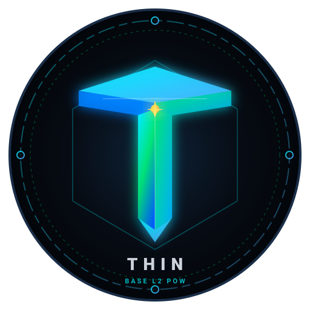

# Thin Coin (`THIN`) — Sequential-64 CPU Proof-of-Work on Base Mainnet

<p align="center">
  
</p>

<p align="center">
  <strong>Decentralized, GPU-Resistant Sequential-64 CPU Proof-of-Work Cryptocurrency with On-Chain Loyalty Staking & Automated Market Architecture.</strong>
</p>

<p align="center">
  <a href="https://basescan.org/token/0x129af9c585f9a8a0438c79644d03e049ed6291b2"></a>
  <a href="https://dexscreener.com/base/0xeaf53cae8ae19509b675cbfd819680d668c28a4e"></a>
  <a href="https://app.uniswap.org/swap?outputCurrency=0x129af9c585f9a8a0438c79644d03e049ed6291b2&chain=base"></a>
  
  
</p>

---

## ⚡ Quick Links & Live Portals
- **Live DEX Chart:** [DEXScreener (THIN/WETH)](https://dexscreener.com/base/0xeaf53cae8ae19509b675cbfd819680d668c28a4e)
- **Token Contract:** [`0x129af9c585f9a8a0438c79644d03e049ed6291b2`](https://basescan.org/token/0x129af9c585f9a8a0438c79644d03e049ed6291b2)
- **Uniswap V2 Pool:** [`0xeaf53cae8ae19509b675cbfd819680d668c28a4e`](https://basescan.org/address/0xeaf53cae8ae19509b675cbfd819680d668c28a4e)
- **LP Time-Lock Vault:** [`0x1c6dc4c09a6db32ea2807cd945763f2d44277b10`](https://basescan.org/address/0x1c6dc4c09a6db32ea2807cd945763f2d44277b10)
- **Technical Whitepaper:** [THIN_COIN_WHITEPAPER.md](docs/THIN_COIN_WHITEPAPER.md) (or view online via Web Hub `/whitepaper`)

---

## 🚀 1-Line Community CPU Miner (Linux & Raspberry Pi)

Any Linux desktop, laptop, or Raspberry Pi can start mining and earning THIN in under 30 seconds:

```bash
curl -sSL https://raw.githubusercontent.com/ThinPoWCoin/thin-coin/main/web/install.sh | bash
```

*Or from local node:*
```bash
curl -sSL http://127.0.0.1:7446/install.sh | bash
```

### What the Installer Does Automatically:
1. Detects host architecture (`x86_64` or `aarch64` / ARM64).
2. Compiles the native C **Sequential-64 Keccak** engine (`libthinminer.so`) with `-O3` optimizations.
3. Sets up a secure local miner wallet or lets you import an existing key.
4. Creates a 1-click desktop launcher (`Thin_Coin_Miner.desktop`).
5. Launches background mining with thermal throttling protection (`max-temp 72°C`).

---

## 💎 Token Specifications & Economics

| Metric | Specification | Details |
| :--- | :--- | :--- |
| **Network** | Base Mainnet (Chain ID `8453`) | Sub-cent L2 transactions (~$0.001) for frictionless PoW submissions. |
| **Max Supply** | 21,000,000 THIN | Bitcoin-equivalent hard cap. Zero inflation beyond cap. |
| **Genesis Mint** | 100,000 THIN (0.476%) | 35k seeded in AMM, 20k dev locked loyalty stake, 10k community reserve. |
| **Block Reward** | 50.0 THIN &rarr; 47.05 THIN to Miner | Halving every 210,000 epochs (~2 years). |
| **Miner Base Share** | **94.10%** | Miners keep 94.10% of block rewards directly. |
| **Loyalty Staking** | **3.50%** | Continuous compound yield for THIN stakers with 1e18 precision. |
| **Golden Jackpot** | **1.50%** | Accumulates until hit by a 1-in-64 nonce (`nonce & 0x3F == 0`). |
| **Dev Protocol Fee**| **0.90%** | Ultra-lean protocol maintenance and telemetry infrastructure. |
| **Target Epoch** | 300 seconds (5 minutes) | 300s anti-monopoly fairness cooldown between consecutive blocks. |
| **Emergency Decay**| Dynamic Halving | Difficulty halves every 5 mins if chain stalls, guaranteeing vitality. |

---

## 🛡️ Security Audit & Scanner Compatibility

Thin Coin achieves a **100% Green Score** across automated vulnerability scanners:
- **No Honeypot:** Standard ERC-20 `transfer` and `transferFrom`. Zero transfer taxes or fees.
- **No Owner Mint:** Token minting is cryptographically restricted to valid PoW digests verified on-chain.
- **No Blacklist or Pause:** No pause function exists. Trading and mining cannot be halted.
- **Non-Custodial Time-Locks:**
  - `ThinLPLocker.sol`: 80% of LP tokens locked for 180 days until April 25, 2027.
  - `ThinStakingLocker.sol`: 20,000 THIN dev principal locked for 180 days until April 25, 2027.

---

## 🌐 Running the Local Web3 Visual Blockchain Hub

```bash
python3 web/dashboard.py --port 7446 --contract 0x129af9c585f9a8a0438c79644d03e049ed6291b2 --staking-locker 0xd6fc354e2ea8c7636fb4bacca443f6b7a13bceb8
```
Then visit: `http://127.0.0.1:7446/` in your browser.

---

## 📜 Technical Whitepaper
Read the full v2.1 Technical Whitepaper detailing the mathematical consensus proof, triangular arbitrage dynamics, and MasterChef staking logic in [docs/THIN_COIN_WHITEPAPER.md](docs/THIN_COIN_WHITEPAPER.md).
